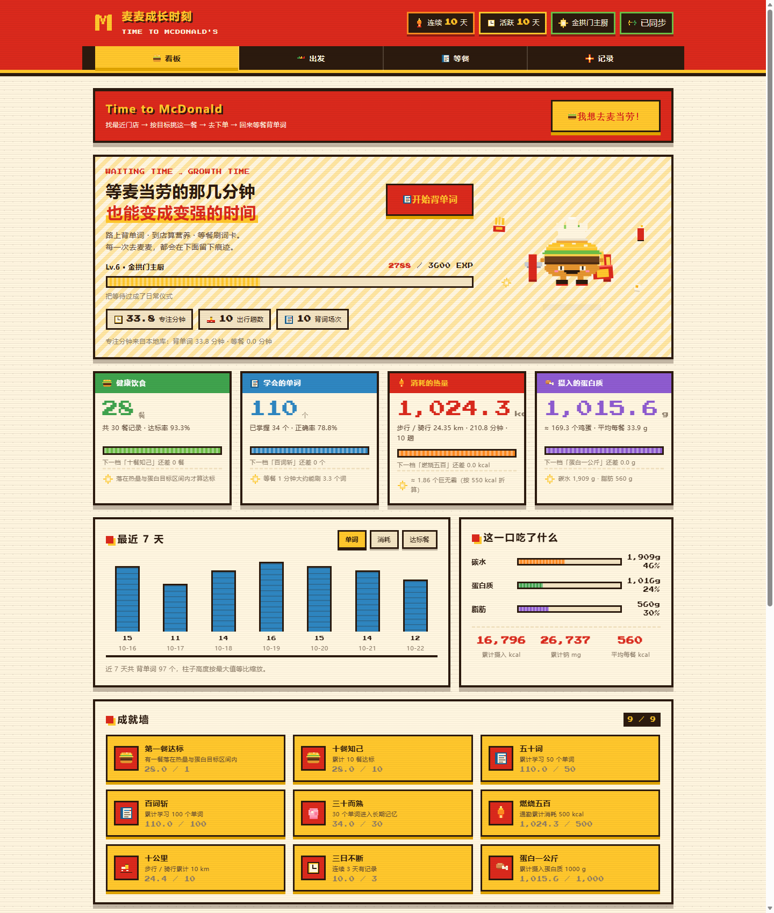
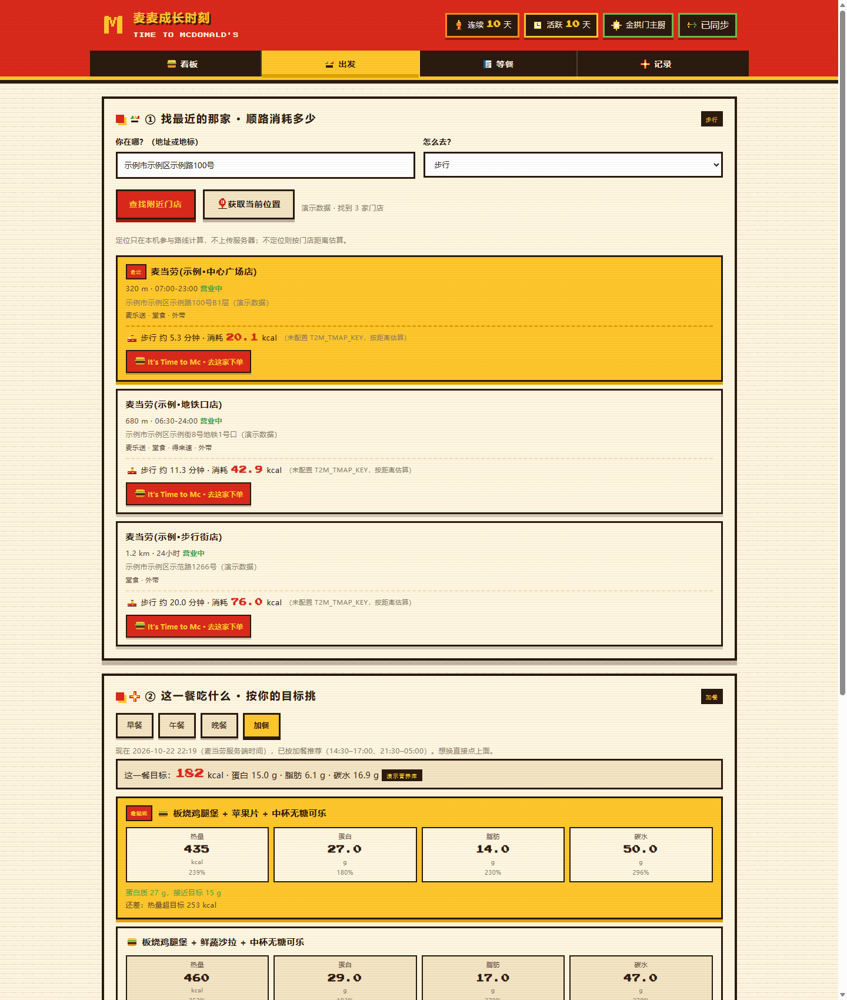
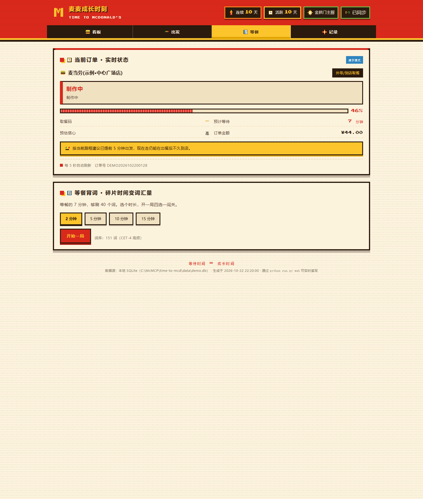
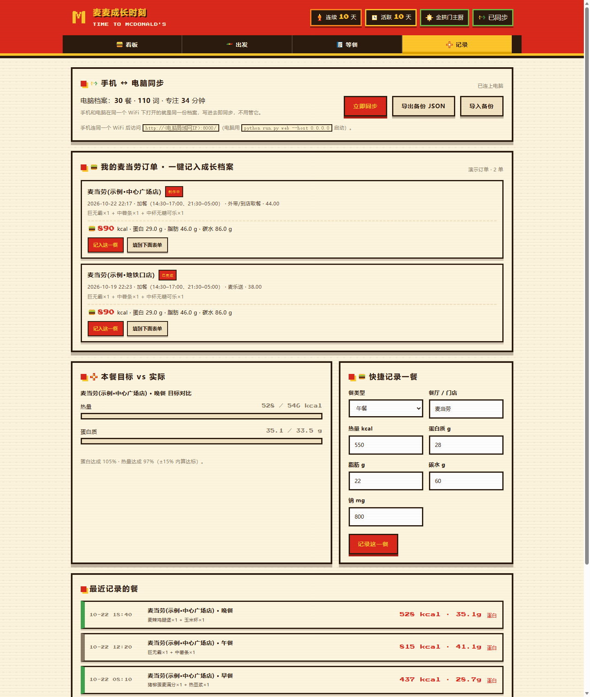
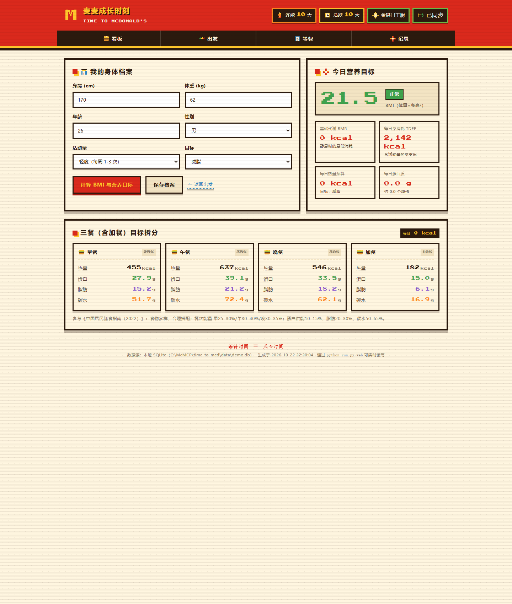
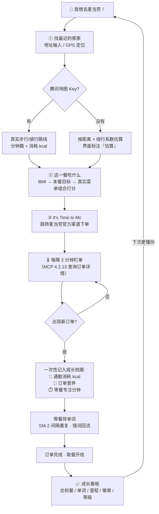

# 🍔 麦麦成长时刻 · Time to McDonald

> **去麦当劳的路，和等麦当劳的那 7 分钟，本来都是被浪费掉的时间。**
> 这个项目把它们换成：走过的公里数、背下来的单词、和一顿刚好达标的饭。

[]()
[]()
[]()
[]()

**麦当劳程序员节创意开发大赛参赛作品** · 非麦当劳官方产品 · 不碰支付、不代下单

---

<div align="center">
  
</div>

## 🤔 为什么要做这个？

一个人从「想吃麦当劳」到「吃到麦当劳」，中间有**两段最无聊的空白**：

```
决定去吃 ──[路上 5–15 分钟]──► 到店/下单 ──[等餐 5–15 分钟]──► 开炫
              ↑ 低头刷手机          ↑ 反复刷订单页
```

市面上的点餐工具都在卷「怎么点单更快」，没有人管这两段空白。
本项目的主张很简单：**等餐时间 = 成长时间**。麦门永不吃亏！

| 时间段 | 原本 | 现在 |
|---|---|---|
| 🚶 路上 | 低头刷手机 | 记录真实步行/骑行路线，知道这一趟抵掉了多少 kcal |
| 🧾 点单前 | 凭感觉点，吃完后悔 | 按你的 BMI 算出这一餐该吃多少，再从**真实菜单**里选组合 |
| ⏳ 等餐 | 焦虑地刷新订单页 | 背单词，答错的词明天自动回来找你（SM-2 间隔重复） |
| 🍔 吃完 | 什么都没留下 | 看板上多了一顿达标餐、几个词、几百大卡、一枚徽章 |

---

## ✨ 功能亮点

### 1️⃣ 我想去麦当劳！—— 一趟有记录的旅程
- 输入地址或一键获取当前位置，**按时间自动选中早餐/午餐/晚餐/加餐**（时间来自麦当劳服务端，不是本机钟表）
- 附近门店 + **腾讯真实步行/骑行路线**：约 4.2 分钟 · 消耗 19.5 kcal，一眼看全
- 每家门店一个 **「It's Time to Mc · 去这家下单」** 按钮 → 跳转麦当劳官方渠道下单
- 下单后**每 2 分钟自动盯单**：一出现新订单，这一趟的通勤消耗 + 这一单的营养 + 等餐时长，**一次性写进成长档案**

### 2️⃣ 这一餐吃什么？—— 你的私人营养教练
- Mifflin-St Jeor 公式算 TDEE，按减脂/维持/增肌拆出本餐热量与蛋白/脂肪/碳水目标
- 从麦当劳真实营养库（158 项）里枚举组合，按「贴目标程度」打分排序
- 营养库查不到的新品？先拆套餐子项，再按**「同类别 + 价格最接近」**的价格锚点估算，并如实标注是估算——绝不像某些 App 一样瞎编数据

### 3️⃣ 等餐背单词 —— 7 分钟也能刷 40 个词
- 订单面板每 5 秒轮询麦当劳 MCP，取餐码/进度/ETA 实时更新
- 根据剩余时间智能推荐「这局刷多少词」
- CET-4 词库 + SM-2 间隔重复：错词第二天准时回来找你，比前任还守时
- 等餐时长自动计成「专注时间」，和背单词时长分开统计、全部落库

### 4️⃣ 成长看板 —— 把日子过成经验条
- 四张像素风数据卡：健康饮食 / 学会的单词 / 消耗的热量 / 摄入的蛋白质
- 8 个等级称号，**吉祥物小汉堡会跟着升级换装**：
  🌱 麦苗新芽（头顶冒芽）→ 🧣 麦香学徒（系上方巾）→ 🍟 薯条骑士（手持薯条+披风）→ 😎 麦麦达人（墨镜）→ 👨‍🍳 金拱门主厨（厨师帽）→ 👑 麦麦传奇（皇冠+闪光）
- 9 枚成就徽章、连续打卡、7 天趋势图——进度条就是最好的多巴胺

### 5️⃣ 手机 ↔ 电脑同步 —— 人出门了，单词不会丢
- 手机带出门断网？**背单词照常进行**：离线壳 + 词库缓存让页面照常打开，记录先排进手机队列（顶栏「待同步 N 条」）
- 回到同一个 Wi-Fi **自动补传**，每条记录带 uid 幂等去重，重试一万次也不会把卡路里算两遍
- 两台设备实在见不到面？「导出备份 JSON → 传文件 → 导入备份」照样合并（同样幂等）

<div align="center">
  <table>
    <tr>
      <td></td>
      <td></td>
    </tr>
    <tr>
      <td></td>
      <td></td>
    </tr>
  </table>
  <p><i>出发 · 等餐 · 记录 · 档案（真实 MCP 联调数据）</i></p>
</div>

---

## 📱 手机上能用吗？

**能，而且专门为「带出门」做了离线同步。** 这是一个本地 Web 应用，手机浏览器访问电脑的地址即可：

1. 电脑上启动 `python run.py web --host 0.0.0.0 --port 8000`（启动时会直接把手机该访问的地址打印出来）
2. 手机连**同一个 Wi-Fi**，浏览器打开 `http://<电脑局域网IP>:8000`
3. 界面是响应式的，手机端会自动切到单列布局（见 `docs/screenshots/m2-go.png`）

### 📴 人出门了，数据怎么办？

手机是要带着去麦当劳的，一出 Wi-Fi 就访问不到电脑——但等餐那几分钟恰恰是最该背单词的时候。所以：

| 场景 | 发生了什么 |
| --- | --- |
| 🏠 在家（同一 Wi-Fi） | 手机和电脑看的就是**同一份数据库**，写进去即同步，什么都不用管 |
| 🚶 出门（断网） | 页面照常能开（Service Worker 离线壳 + 词库缓存），**背单词、记一餐、记通勤照常进行**，写操作先排进手机的待发队列，顶栏显示「待同步 N 条」 |
| 🏠 回家（连回 Wi-Fi） | 页面探测到电脑上的服务，**自动把攒下的记录补传**上去；每条记录自带 uid，重复上传只会落一次，卡路里和单词数绝不会被算两遍 |
| 📦 见不到面（极端情况） | 记录屏的「导出备份 JSON」把档案导成文件 → 微信/AirDrop 传到电脑 → 「导入备份」合并进去（同样按 uid 幂等） |

> 顶栏的「同步」chip 和记录屏的「手机 ↔ 电脑同步」面板随时显示状态：电脑档案有多少餐/多少词、上次同步时间、手机该访问的局域网地址。
>
> 💡 启动器会自动识别局域网 IP；装了 Clash 等代理软件也不会把虚拟网卡地址当成 Wi-Fi 地址给你。

**它和 WorkBuddy / AI 助手是什么关系？** 项目本体是麦当劳 MCP + 本地 Web，
不依赖特定 AI 平台；同时它也是一个标准 MCP 工具集，可以接到任何支持 MCP 的
AI 助手里对话式使用（详见 [WORKBUDDY.md](WORKBUDDY.md)）。

---

## 🚀 快速开始

```bash
# 1. 克隆 + 直接跑（无需安装任何依赖，Python 3.10+ 即可）
git clone https://github.com/<you>/growth-time-to-mcd.git
cd growth-time-to-mcd

# 2. 启动（首次可先看演示数据）
python run.py web --demo          # 演示模式：内置数据 + 假订单，联调真实数据用下面这条
python run.py web                 # 真实模式：读 .env 里的 Token 调麦当劳 MCP

# 3. 打开浏览器
#    http://127.0.0.1:8000  →  点「我想去麦当劳！」
```

> 想先玩 CLI？`python run.py journey --address "上海市人民广场" --mode walk`

---

## 🔑 配置说明

### ① 麦当劳 MCP Token（必需）

比赛方发放的 MCP 接入 Token，写入项目根目录 `.env`（参考 `.env.example`）：

```ini
MCD_MCP_TOKEN="你的麦当劳MCP令牌"
```

| 现象 | 说明 |
|---|---|
| 403 | Token 缺失或未开通该工具权限 |
| 401 | Token 无效 |
| 没配会怎样 | 自动进入演示模式，界面明确标注「演示数据」，绝不冒充真实数据 |

### ② 腾讯位置服务 Key（可选，但强烈推荐）

没有它，步行/骑行消耗按「距离 × 经验绕行系数」估算；有了它，就是真实路径规划。

1. 到 [腾讯位置服务](https://lbs.qq.com/) 注册并创建应用，拿到 Key
2. 写进 `.env`：`T2M_TMAP_KEY="你的腾讯Key"`
3. **关键**：控制台 → 配额管理，给这把 Key 分配以下服务（按服务分别统计，缺一个就只能估算）：

| 必需 | 服务名（控制台里的名字） | 路径 | 个人日额度 |
|:--:|---|---|---|
| ✔ | 地址解析-地址转坐标和地址信息 | `/ws/geocoder/v1/?address=*` | 6000 |
| ✔ | 路线规划-步行 | `/ws/direction/v1/walking` | 6000 |
| ✔ | 路线规划-骑行 | `/ws/direction/v1/bicycling` | 6000 |
| 可选 | 逆地址解析-坐标转地址信息 | `/ws/geocoder/v1/?location=*` | 6000 |

4. 配完随时体检：`python tools/check_quota.py`

**本地限流**：默认 1 次/秒、100 次/日（`T2M_TMAP_MAX_PER_SEC` / `T2M_TMAP_MAX_PER_DAY` 可调），
路线结果缓存 7 天——同一段路只花一次配额。超限自动降级为距离估算，并在界面上**如实标注**降级原因。

### ③ 没有任何 API？

照样能用！地图缺失时按距离估算热量；MCP 未配置时进入演示模式。
所有降级都会在界面上写明，**从不把估算值伪装成真实数据**。

---

## 🗺️ 完整工作流



---

## ⌨️ 也给喜欢终端的人：CLI 一览

| 命令 | 干什么 |
|---|---|
| `python run.py doctor` | 体检：Token、地图、MCP 工具、本地档案 |
| `python run.py tools --used` | 列出本项目用到的 MCP 工具与参数 |
| `python run.py profile set --height 178 --weight 72 --age 30 --goal lose` | 建立身体档案 |
| `python run.py near --address "上海市人民广场" --mode walk` | 最近门店 + 通勤消耗 |
| `python run.py preorder --meal auto --limit 3` | 按目标推荐这一餐（`auto` = 按当前时间选餐次） |
| `python run.py play --from-order` | 等餐背单词（按订单剩余时间自动定时长） |
| `python run.py wait` | 候餐进度与出发建议 |

所有子命令都支持 `--mock`（离线演示）、`--json`（机器可读）、`--out`（报告落盘）。

## 🏗️ 项目结构

```
growth-time-to-mcd/
├── run.py                  # 免安装启动器（评委不用 pip install）
├── src/time_to_mcd/
│   ├── web_app.py          # 本地 Web 服务（标准库 ThreadingHTTPServer，零依赖）
│   ├── service.py          # 业务编排：门店 / 营养 / 订单 / 通勤
│   ├── mcp_client.py       # 麦当劳 MCP 客户端（JSON-RPC over HTTP）
│   ├── coach.py            # 营养教练：TDEE → 本餐目标 → 组合打分
│   ├── wait.py             # 候餐引擎：ETA / 进度 / 订单归一化
│   ├── words.py            # 背单词引擎（SM-2 间隔重复）
│   ├── geo.py              # 腾讯位置服务 + 本地限流（1 次/秒、100 次/日）
│   ├── nutrition.py        # 营养解析 + 价格锚点估算
│   └── store.py            # SQLite 成长档案
├── web/                    # 像素风前端（原生 JS，无构建步骤）
├── tools/                  # 演示数据 / 词库导入 / 配额体检
├── tests/                  # 136 项单元测试
└── docs/                   # 使用手册 · 截图 · 流程图
```

## 🧪 质量

- **136 项单元测试全绿**（`python -m unittest discover -s tests`）
- 真实联调修复了 10+ 个 mock 掩盖不了的结构坑（订单明细字段、状态码语义、同名异地解析……全部记录在 [MCP_INTEGRATION.md](MCP_INTEGRATION.md)）
- 隐私设计：Token 只在服务端、定位坐标不上传不入库、个人成长档案只存本地 SQLite

## ⚖️ 合规声明

- 非麦当劳官方产品；下单一律跳转官方渠道，**本项目不调下单接口、不碰支付、不存储账号**
- 比赛合规声明见 [CONTEST_DECLARATION.md](CONTEST_DECLARATION.md)
- 演示模式（`--demo`）连订单都用假数据，投屏演示不会泄露个人账号信息

## License

MIT


## 最后的最后
依赖Workbuddy的一日极致摸鱼开发，非官方产品。懒得大改介绍，就在这里叨叨吧。可以导入自己需要的单词书。如果你想更加的方便快捷，或许你可以考虑借助WorkBuddy修改一下进入麦当劳微信小程序，或者跳转麦当劳app。最后打包个安装包或者什么形式在手机上用用也不是不行。高中时候每次走去麦当劳要25min、午饭时间还要等餐等很久就有很强烈的时间焦虑，基本一个中午都搭进来了。如果那时候有这么先进的电子设备，就可以边等麦边背单词了。也不至于当时中午在麦当劳抓耳挠腮无助抠手，仔仔细细看遍橱窗里所有的小玩具和店里的每一块海报。想想自己高中3年所有单词听写都是抄过来的，现在终于是有了报应，这个参赛作品也算是给高中时候的一个纪念。 
我爱薯条，麦门永存（虽然我做的是成长小汉堡）
